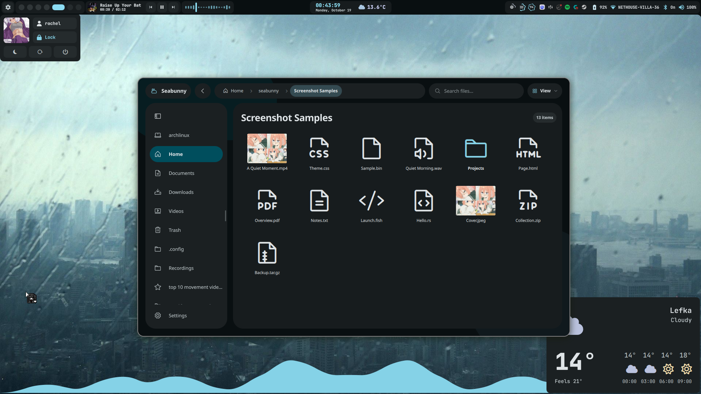
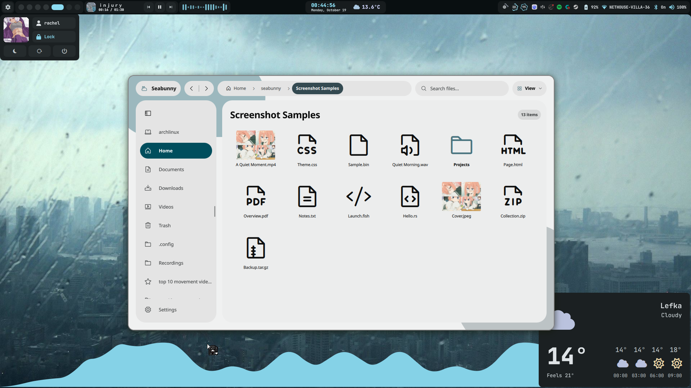
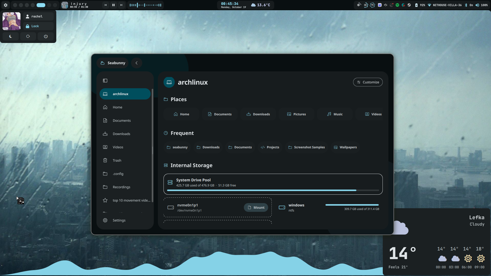
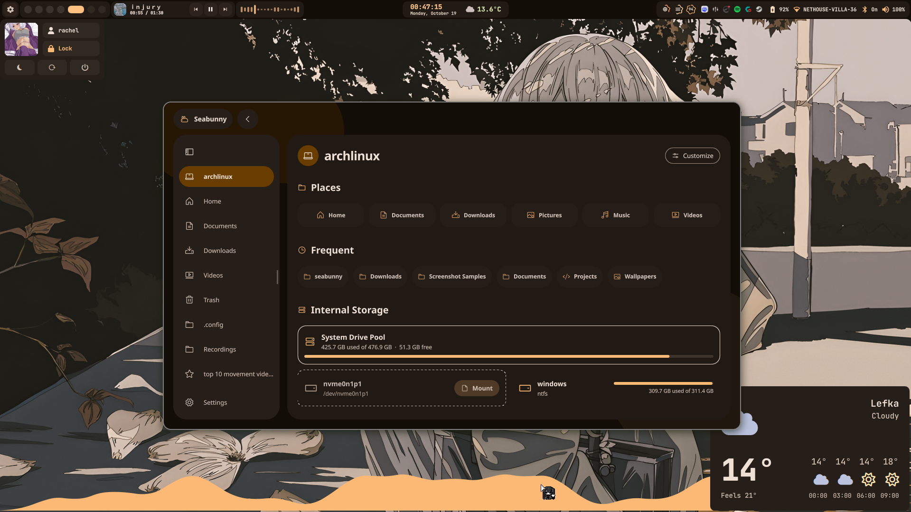

# seabunny

a file manager. for managing files. groundbreaking stuff.

this branch is **seabunny 0.2.0**, rebuilt on the newer upstream architecture.
the installed 0.1 build can stay put while this one gets tested.
[what changed and how to try it](NEXT-VERSION.md).

i wanted my folders to look nice and stuff so that became a rust + qt/qml project.
there are tabs. there are thumbnails. the sidebar remembers where i left it.
i've spent an unreasonable amount of time looking at little rectangles.

fuck it. the rectangles look good.

anyway. i use it on cachyos with niri. that's the setup getting actual use, so
keep that in mind if you're bringing it somewhere else.

## look at her

yeah theres 4 of them. i really wanted you to see that it changes colors.
yes, the spacing is deliberate. i have been incredibly annoying about it.

| dark | light |
| --- | --- |
|  |  |
|  |  |

## things i put in here

- grid and list views, tabs, split view, recursive search, and the keyboard shortcuts your hands already know
- background file operations with progress and cancellation, batch rename, and quick look
- large previews, square grid cells, and ctrl+scroll zoom from compact to properly big
- image and video thumbnails. the videos don't start playing every time you scroll past them
- a sidebar you can resize and rearrange, with bookmarks and saved open/closed state
- per-folder sorting. only folders with custom sorting need a saved entry
- hidden files shown by default. ctrl+h if you'd rather pretend `.config` doesn't exist
- trash, restore, copy/paste, drag and drop, and undo/redo for when you do some stupid shit
- copy files between windows or other file managers with the system clipboard. paste into the same folder to make a numbered copy
- merge matching folders, then choose what to keep for clashing files. there's an apply-to-all switch too
- read-only archive browsing and extraction
- file permissions in properties, including a make executable switch. no terminal detour
- open with lets you pick an app and save it as the default for that file type
- executable programs and AppImages actually run instead of getting dumped into your browser
- automatic live Serpantinum colors, built-in palettes, light/dark modes, and reduced motion
- Phosphor, Serpantinum Symbols, system icons, and Adwaita, all in the normal settings
- a matching file picker for apps using desktop portals. yes, i got distracted by that too

f2 renames. delete sends things to trash. ctrl+shift+n makes a folder. f5 refreshes.
the rest are in [HOTKEYS.md](HOTKEYS.md). there's a table. very official.

## okay, build it

the dependency list got a little long. you'll need rust/cargo, a c++ compiler,
cmake, ninja, pkg-config, qt 6 (base, declarative/quick, svg, and wayland), and
KDE Frameworks 6 WindowSystem, and GLib/GIO development files (`gio-unix-2.0`).

python 3 and libarchive handle archives. ffmpeg adds video thumbnails. zip and 7z
are used for the compression formats that need them.

run these from the repo root:

```fish
cargo build --release --locked
./target/release/seabunny
```

folder paths, archives, and local file urls all work as arguments.

for a separate development profile, use `fish ./run-development.fish` after building.
it opens a new window without changing your installed app or portal routing.
try the development file picker separately with `fish ./test-file-picker.fish`.
that opens five test dialogs on a private bus. no installing, no changing your
current picker, no desktop renovation bullshit. `--case save` runs just Save As.

there isn't a published release or AUR package yet, so you'll need to build from
source. the Nix recipe is here too, but it hasn't been verified for this snapshot.
its presence in the repo is not a spiritual guarantee that it works.
if you try it and it falls on its ass, the details would actually be useful.

## put it on your computer

the local installer keeps versioned copies. your previous build gets to stay
around when you update. occasionally the old thing working is useful information.

```fish
python3 -B packaging/seabunny/package_user.py build --with-portal
```

it prints a package directory. put that path here:

```fish
fish packaging/seabunny/install-user.fish --package /absolute/path/to/package
```

the launcher lives in `~/.local/bin`. add that to your PATH if it isn't there.
you have to pass `--make-default` to change the default folder handler, and the
portal still needs enabling separately. installing a file manager shouldn't become
a surprise desktop renovation.

settings go in `~/.config/seabunny`. sidebar and sorting state go under
`~/.local/state/seabunny`. the documented XDG directory overrides work too.
[the installation guide has the details](packaging/seabunny/README.md).

## naturally, there's a file picker

it's a separate `xdg-desktop-portal-seabunny` process. you can close a picker and
your file-manager window stays right where it was. the app opening the dialog
still does its own reading and writing.

registration and enabling are separate steps. you can pick seabunny just for
FileChooser and keep your existing backends for screen sharing and everything
else. keep the rollback instructions handy the first time. optimism is not a
recovery procedure.

[setup, testing, and how to go back](packaging/seabunny/PORTAL.md).

## yes, there are tests

moving files around is the entire fucking job, so there are checks for that.

```fish
python3 -B tests/next/run_rust.py
python3 -B tests/test_archives.py
python3 -B tests/test_portal_install.py
python3 -B tests/next/run_checks.py
cmake -S tests -B /tmp/seabunny-qt-tests
cmake --build /tmp/seabunny-qt-tests -j 2
python3 -B tests/next/run_native.py --build-dir /tmp/seabunny-qt-tests
python3 -B tests/next/run_wayland.py
```

the new UI checks use temporary profiles. the Wayland clipboard check uses a
private virtual KWin session, because borrowing your actual clipboard for a test
would be annoying as hell. KWin and QtTest are test dependencies, not app requirements.
the older 0.1 UI harnesses are kept for reference; use `tests/next` for this branch.
[more test details and remaining limits](NEXT-VERSION.md).

it's still early. archive editing isn't supported. upstream's optional SMB and
sharing features are present, but haven't been tested against a real server here.
sharing needs an existing cloudflared installation; the app won't download one.

bugs, suggestions, weird screenshots: all welcome. open an issue and tell me
what you did, what happened, and what you expected. include your distro and desktop
setup if it seems relevant. i use this thing too, so i'd quite like to fix it.
there's a decent chance the thing annoying you also annoys the shit out of me.

[third-party notices and license status](NOTICE.md).

anyway. that's seabunny. it opens folders and i have opinions about the spacing.
